# 🎯 Lead Qualifier: Pré-SDR com IA para prospecção outbound

Prova de conceito (PoC) para o hackathon **IA Operacional e Produtividade no Trabalho**, trilha **Tecnologia & TI**.

O sistema lê a lista real de projetos aprovados num edital de inovação (ex.: **Programa Centelha**), **descobre sozinho o CNPJ e o contato** do proponente ou da startup, usa uma IA gratuita (**Groq**) como **Pré-SDR** para dar uma **nota de fit** a cada projeto e entrega tudo num **mini-CRM em Streamlit**.

> **Custo: R$ 0.** Groq (camada gratuita), minhareceita.org e BrasilAPI (dados abertos), Streamlit e Playwright (open source).

---

## Sumário

1. [Como funciona](#como-funciona)
2. [Estrutura do projeto](#estrutura-do-projeto)
3. [Instalação](#instalação)
4. [Configuração](#configuração)
5. [Como rodar](#como-rodar)
6. [Diagnóstico: quando algo falha](#diagnóstico-quando-algo-falha)
7. [Regra de contato](#regra-de-contato)
8. [Guardrails contra alucinação](#guardrails-contra-alucinação)
9. [Privacidade, LGPD e termos de uso](#privacidade-lgpd-e-termos-de-uso)
10. [Limitações conhecidas](#limitações-conhecidas)
11. [Roteiro da demonstração](#roteiro-da-demonstração)

---

## Como funciona

```mermaid
flowchart LR
    A["Página do edital<br/>(Centelha DF)"] -->|"Playwright:<br/>acha o PDF"| B["1. Extração<br/>nome, projeto, temática"]
    B --> C["2. Busca automática<br/>do CNPJ"]
    C -->|"nome do sócio,<br/>nome da startup"| D["Casa dos Dados<br/>cnpj.biz · buscador"]
    D -->|"candidatos"| E["Conferência no cadastro<br/>oficial (QSA, UF, ativa)"]
    E --> F["Regra de contato<br/>telefone / e-mail"]
    F --> G["3. Pré-SDR<br/>Groq + guardrails"]
    G --> H[("leads_processados.json")]
    H --> I["4. Streamlit<br/>mini-CRM"]
```



| # | Etapa | O que faz |
|---|-------|-----------|
| 1 | **Extração** | Abre a página real do edital, encontra o PDF de resultado (inclusive em links do Google Drive) e lê a tabela. |
| 2 | **CNPJ + contato (automático)** | Procura o CNPJ pelo **nome do proponente** (como sócio ou MEI) e pelo **nome da startup** tirado do título do projeto. **Cada candidato é conferido no cadastro oficial**; só é atribuído se o proponente for sócio/titular (ou o nome da startup bater), a empresa estiver ativa e for da UF do edital. Com o CNPJ vinculado, aplica a [regra de contato](#regra-de-contato). |
| 3 | **Pré-SDR (IA)** | O Groq devolve JSON estruturado com nota (0 a 10), confiança, justificativa, serviços sugeridos e evidências literais, protegido por guardrails. |
| 4 | **Painel** | Tabela interativa, filtros, detalhe do lead (com a origem do CNPJ e o status de cada contato) e funil comercial. |

**Por que conferir cada candidato?** A busca por nome pode devolver homônimos. Os sites só *geram candidatos*; quem decide é o cadastro oficial (quadro societário, razão social de MEI, UF e situação). Se houver dois candidatos igualmente prováveis, o lead fica **ambíguo** e nenhum CNPJ é atribuído.

---

## Estrutura do projeto

```
lead-qualifier-poc/
├── app.py                       # Etapa 4: painel Streamlit
├── pipeline.py                  # Orquestra as etapas 1, 2 e 3
├── requirements.txt
├── .env.example                 # copie para .env e coloque a chave do Groq
│
├── extracao/                    # Etapa 1
│   ├── scraper.py               # Playwright + pdfplumber, links do Google Drive
│   └── validacao.py             # validação de CNPJ (inclui o formato alfanumérico)
│
├── enriquecimento/              # Etapa 2
│   ├── descoberta.py            # nome -> CNPJs candidatos (Casa dos Dados, cnpj.biz, web)
│   ├── brasilapi.py             # CNPJ -> cadastro oficial (minhareceita.org + BrasilAPI)
│   ├── identidade.py            # este CNPJ é mesmo da pessoa/startup?
│   ├── contato.py               # regra de telefone e e-mail
│   └── orquestrador.py          # junta tudo; gera data/cnpjs_encontrados.csv
│
├── classificacao/               # Etapa 3
│   ├── perfil.py                # ✏️ o que a SUA empresa vende (editar)
│   ├── llm.py                   # Groq (API compatível com OpenAI), cache, diagnóstico
│   └── guardrails.py            # schema estrito + validações anti-alucinação
│
└── data/
    ├── brutos/                  # PDFs baixados
    ├── cnpjs_encontrados.csv    # AUTOMÁTICO: o que a busca achou, com evidência
    ├── cnpjs_manuais.csv        # OPCIONAL: correções da equipe (proponente,cnpj)
    ├── leads_processados.json   # saída lida pelo painel
    └── cache_*.json, crm_estado.json   # caches e funil (ignorados pelo git)
```

> `cnpjs_manuais.csv` pode ficar vazio: a busca é automática. Ele serve só para **corrigir** um lead que a busca errou ou não achou, e tem prioridade sobre a busca.

---

## Instalação

**Requisitos:** Python **3.10+**.

```powershell
python -m venv .venv
.venv\Scripts\Activate.ps1              # Windows (PowerShell)
# source .venv/bin/activate             # Linux / macOS

pip install -r requirements.txt
python -m playwright install chromium   # uma vez só
```

---

## Configuração

### Chave gratuita do Groq

1. Crie uma chave em <https://console.groq.com/keys> (não pede cartão).
2. Copie `.env.example` para `.env` e preencha:

```env
GROQ_API_KEY=gsk_...
GROQ_MODEL=            # opcional; padrão: openai/gpt-oss-20b
GROQ_PAUSA=2           # segundos entre chamadas (a camada gratuita tem limite por minuto)
```

O `.env` está no `.gitignore`. **Nunca** suba a chave para o repositório.

### Perfil da empresa

Edite `classificacao/perfil.py` com o que **vocês** vendem. A nota de fit depende disso.

---

## Como rodar

```powershell
# Teste barato: só 3 chamadas ao LLM
python pipeline.py --pagina https://programacentelha.com.br/df/ --max-ia 3

# Rodada completa (extração + CNPJ + contatos + IA)
python pipeline.py --pagina https://programacentelha.com.br/df/

# Painel
streamlit run app.py        # ou: python -m streamlit run app.py   -> http://localhost:8501
```

Opções do pipeline: `--sem-ia`, `--sem-busca-cnpj` (usa só o CSV manual), `--sem-cache-cnpj`, `--uf DF`, `--max-ia N`.

Depois de cada rodada, abra `data/cnpjs_encontrados.csv` para **auditar** o que foi achado e com que evidência.

---

## Diagnóstico: quando algo falha

| Sintoma | Comando | O que mostra |
|---------|---------|--------------|
| Nota não aparece / IA falhando | `python -m classificacao.llm --testar` | Faz 1 chamada real e mostra o erro exato (chave, modelo, limite) |
| Quais modelos minha chave enxerga? | `python -m classificacao.llm --modelos` | Lista os modelos disponíveis |
| CNPJ não é encontrado | `python -m enriquecimento.orquestrador --diagnostico "Nome do Proponente" --titulo "Título do projeto"` | Resultado de cada fonte (HTTP, bloqueio, nº de candidatos) e o veredito da conferência de cada candidato |
| Colunas do PDF erradas | `python -m extracao.scraper --pagina URL --inspecionar` | Linhas do PDF com índices, para ajustar `--colunas` |

No painel, o campo **Status da IA** e os avisos do detalhe do lead dizem por que uma nota está ausente (`sem_chave`, `falha`, `nao_processado`).

---

## Regra de contato

Um telefone ou e-mail **só entra na coluna principal** quando **todas** as condições valem:

1. está **completo** (sem dígitos ocultos; DDD válido; 8 ou 9 dígitos);
2. **não** é de contabilidade, coworking, recepção ou condomínio;
3. **não** se repete em CNPJs diferentes (sinal de contador/escritório);
4. o CNPJ foi **vinculado** ao proponente/startup;
5. há **corroboração**: e-mail no domínio ou com o nome da própria startup/pessoa, **ou** o CNPJ é de MEI/empresário individual no nome do proponente.

Em qualquer outro caso o número **não vai para a coluna principal**, e o motivo aparece de forma explícita: `dígitos ocultos`, `incompleto`, `contabilidade`, `coworking/recepção`, `compartilhado` ou `não confirmado`. O número do cadastro, quando existe, aparece só no detalhe do lead, rotulado como **não confirmado**.

Mesmo um contato "confirmado" vem do cadastro do CNPJ e pode ter sido preenchido pelo contador; por isso o painel mostra a **confiança** (alta/média) e a observação.

---

## Guardrails contra alucinação

| Camada | O que garante |
|--------|---------------|
| **Dados enviados ao LLM** | Só título, temática e município (mais CNAE/porte). O prompt trata o texto do projeto como **dado**, nunca como instrução. |
| **Schema JSON estrito** | No Groq, modelos com Structured Outputs estrito (ex.: `openai/gpt-oss-20b`) só devolvem campos e valores permitidos. Outros modelos usam JSON Object Mode, com o mesmo schema no prompt. |
| **Validação em Python** | Nota inteira de 0 a 10, serviços do catálogo; resposta inválida é rejeitada e o modelo corrige (até 3 tentativas). |
| **Ancoragem** | Cada evidência precisa ser trecho **literal** dos dados; senão é descartada e o lead vai para `revisar`. |
| **Regras determinísticas** | Dados insuficientes limitam a nota a 4; nota alta sem evidência cai para 6; termos como *faturamento* ou *investidores* sem base geram aviso. |
| **Conferência de CNPJ** | Dígito verificador validado e candidato conferido no cadastro (sócio/MEI, UF, situação ativa). Ambíguo ou fraco **não é atribuído**. |

Falhas de rede, bloqueios e limites nunca derrubam o pipeline: viram status por lead. Respostas do LLM, buscas e cadastros ficam em **cache**, o que poupa a cota gratuita e deixa a demo estável.

---

## Privacidade, LGPD e termos de uso

- O **nome do proponente não é enviado** ao LLM. No painel, ele fica **oculto por padrão**.
- Os dados usados (lista de aprovados e cadastro de CNPJ) são **públicos**, mas telefone e e-mail de MEI/sócio são dados pessoais ligados a uma pessoa física. Para contato comercial, trabalhe com **interesse legítimo**, identifique-se, ofereça opt-out e não use os dados para outra finalidade.
- **Termos de uso dos sites.** A busca por nome usa o endpoint público de pesquisa da Casa dos Dados, páginas do cnpj.biz e um buscador web. **Esses sites podem restringir acesso automatizado.** O código reduz o risco: respeita o `robots.txt`, espera ~2,5 s entre requisições, usa cache, para no primeiro site que responde e, se houver bloqueio ou captcha, **registra e segue em frente, sem tentar contornar**. Confira os termos de cada site antes de uso além do PoC. A Casa dos Dados também oferece uma API oficial com chave (`https://docs.casadosdados.com.br`) e os dados-fonte são os arquivos abertos da Receita Federal.
- Chaves ficam só no `.env`.

---

## Limitações conhecidas

- **A busca de CNPJ depende de sites externos.** O endpoint público da Casa dos Dados e as páginas do cnpj.biz **não têm contrato de estabilidade** e podem mudar ou bloquear. O código foi testado contra servidores simulados, **não contra os sites reais**. Use `--diagnostico` na primeira rodada. Se todas as fontes falharem, o lead fica `sem_cnpj` e o CSV manual cobre os casos importantes.
- **Nem todo proponente tem CNPJ ainda.** Muitos projetos são de pessoa física que abre a empresa só após a contratação; nesses casos `sem_cnpj` é o resultado correto.
- **Homônimos.** A conferência reduz o risco, mas não o elimina; revise os leads `confiança média` antes de abordar.
- **Contato do cadastro é incerto por natureza** (pode ser do contador). A regra acima é conservadora de propósito: poucos números na planilha, mas com motivo claro.
- **A IA decide com pouco texto** (título e temática): a nota é uma priorização, não um veredito.
- **Camada gratuita do Groq** tem limite de requisições por minuto/dia; o código espera e usa cache, mas uma rodada de muitos leads pode precisar ser feita em partes.
- Não há suíte de testes automatizados no repositório; as peças foram testadas manualmente com dados e servidores simulados.

---

## Roteiro da demonstração

1. **Terminal:** rode o pipeline (PDF real, busca de CNPJ, contatos, IA) e mostre `data/cnpjs_encontrados.csv`.
2. **Painel:** filtre por **alto fit** e por **telefone confirmado**.
3. **Detalhe:** mostre a justificativa com trechos literais e **como o CNPJ foi encontrado** (evidência e confiança).
4. **Contato claro:** abra um lead com contato **bloqueado** (contabilidade, compartilhado ou dígitos ocultos) e mostre o motivo.
5. **Guardrail:** abra um lead em `revisar` ou `ambíguo`.
6. **CRM:** mova um lead para *Contatado*, anote e exporte o CSV.

---

**Stack:** Python 3.10+ · Playwright · pdfplumber · requests · Groq (SDK `openai`) · minhareceita.org / BrasilAPI · Streamlit · pandas

**Equipe:** _(preencha os nomes)_