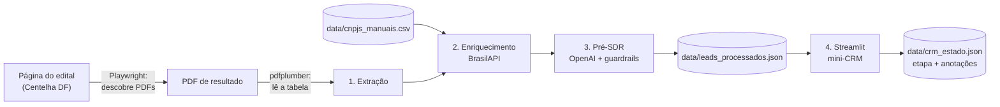

# Lead Qualifier: Pré-SDR com IA para prospecção outbound

Prova de conceito (PoC) para o hackathon **IA Operacional e Produtividade no Trabalho**, trilha **Tecnologia & TI**.

O sistema encontra projetos aprovados em editais públicos de inovação (ex.: **Programa Centelha**), enriquece os dados, usa uma IA como **Pré-SDR** para dar uma **nota de fit** a cada projeto e entrega tudo num **mini-CRM em Streamlit**, para o SDR começar o dia pelos leads que mais importam.

> **Em uma frase:** em vez de o SDR pesquisar dezenas de projetos um a um, a IA lê, pontua e justifica cada um, citando trechos dos próprios dados, e o SDR só gasta tempo nos melhores.

---

## Sumário

1. [O problema e a solução](#o-problema-e-a-solução)
2. [Arquitetura](#arquitetura)
3. [Estrutura do projeto](#estrutura-do-projeto)
4. [Instalação](#instalação)
5. [Configuração](#configuração)
6. [Como rodar](#como-rodar)
7. [Guardrails contra alucinação](#guardrails-contra-alucinação)
8. [Tratamento de falhas](#tratamento-de-falhas)
9. [Privacidade e LGPD](#privacidade-e-lgpd)
10. [Limitações conhecidas](#limitações-conhecidas)
11. [Roteiro da demonstração](#roteiro-da-demonstração)
12. [Stack](#stack)

---

## O problema e a solução

**Problema.** Listas de aprovados em editais são uma fonte excelente de leads: são empresas nascentes de base tecnológica, prestes a investir em produto. Mas elas chegam em PDF, sem CNPJ e sem resumo do projeto, e qualificar dezenas de linhas manualmente consome o tempo do SDR.

**Solução.** Um pipeline em quatro etapas:

| # | Etapa | O que faz |
|---|-------|-----------|
| 1 | **Extração** | Abre a página real do edital (Playwright), encontra o PDF de resultado, inclusive em links do Google Drive, e lê a tabela (pdfplumber). |
| 2 | **Enriquecimento** | Valida o CNPJ (dígito verificador) e consulta a **BrasilAPI**: razão social, CNAE, porte, situação cadastral. |
| 3 | **Pré-SDR (IA)** | A OpenAI devolve **JSON estruturado** com nota de fit (0 a 10), confiança, justificativa, serviços sugeridos e evidências, protegido por guardrails. |
| 4 | **Painel** | Mini-CRM em **Streamlit**: tabela interativa, filtros, detalhe do lead e funil comercial. |

---

## Arquitetura



Cada etapa é um pacote independente com funções pequenas e testáveis. O `pipeline.py` orquestra as três primeiras, e o `app.py` apenas **lê** o resultado. Isso significa que, se a rede ou a API falharem durante uma apresentação, o painel continua abrindo com o último resultado bom.

---

## Estrutura do projeto

```
lead-qualifier-poc/
├── app.py                      # Etapa 4: painel Streamlit (streamlit run app.py)
├── pipeline.py                 # Orquestra as etapas 1, 2 e 3 e salva o JSON
├── requirements.txt
├── .env.example                # Modelo das variáveis de ambiente (copie para .env)
├── .gitignore
│
├── extracao/                   # Etapa 1
│   ├── scraper.py              # Playwright + pdfplumber, links do Google Drive, CLI
│   └── validacao.py            # Validação de CNPJ (inclui o formato alfanumérico)
│
├── enriquecimento/             # Etapa 2
│   └── brasilapi.py            # Consulta à BrasilAPI com retry e tratamento de 404/429
│
├── classificacao/              # Etapa 3
│   ├── perfil.py               # O que a SUA empresa vende (editar antes de rodar)
│   ├── llm.py                  # Prompt, chamada à OpenAI, cache e lote
│   └── guardrails.py           # Schema estrito + validações anti-alucinação
│
└── data/
    ├── brutos/                 # PDFs baixados (ignorado pelo git)
    ├── cnpjs_manuais.csv       # CNPJs levantados pela equipe (proponente,cnpj)
    ├── leads_processados.json  # Saída do pipeline, lida pelo painel
    ├── cache_classificacao.json# Cache das respostas da IA (ignorado pelo git)
    └── crm_estado.json         # Etapas e anotações do SDR (ignorado pelo git)
```

---

## Instalação

**Requisitos:** Python **3.10 ou superior** e uma chave de API da OpenAI.

```powershell
# 1) Crie e ative um ambiente virtual
python -m venv .venv
.venv\Scripts\Activate.ps1          # Windows (PowerShell)
# source .venv/bin/activate         # Linux / macOS

# 2) Instale as dependências
pip install -r requirements.txt

# 3) Baixe o navegador usado pelo Playwright (uma vez só)
python -m playwright install chromium
```

---

## Configuração

### 1. Variáveis de ambiente (`.env`)

Copie `.env.example` para `.env` na raiz e preencha:

```env
OPENAI_API_KEY=sk-...
OPENAI_MODEL=nome-do-modelo
```

`OPENAI_MODEL` deve ser um modelo disponível na sua conta e com suporte a **Structured Outputs**. O padrão do código é `gpt-4o-mini`. O `.env` está no `.gitignore`: **nunca** suba a sua chave para o repositório.

### 2. Perfil da empresa (`classificacao/perfil.py`)

A nota de fit só faz sentido se a IA souber o que **vocês** vendem. Edite `EMPRESA_DESCRICAO` e `CATALOGO_SERVICOS`. As chaves do catálogo são as únicas aceitas na saída da IA.

### 3. CNPJs conhecidos (`data/cnpjs_manuais.csv`)

As listas oficiais de aprovados **não trazem CNPJ**, e a BrasilAPI consulta **apenas por CNPJ**. Para os leads que a equipe quiser enriquecer, preencha:

```csv
proponente,cnpj
Nome Completo Como Na Lista,12.345.678/0001-95
```

O nome é comparado sem diferenciar acentos e maiúsculas. Leads sem CNPJ continuam no painel com o status `sem CNPJ`.

---

## Como rodar

### Gerar os dados (terminal, a partir da raiz)

```powershell
# Teste barato: só 3 chamadas à OpenAI
python pipeline.py --pagina https://programacentelha.com.br/df/ --max-ia 3

# Rodada completa
python pipeline.py --pagina https://programacentelha.com.br/df/

# Sem IA (só extração + BrasilAPI)
python pipeline.py --pagina https://programacentelha.com.br/df/ --sem-ia
```

O pipeline grava `data/leads_processados.json`, ordenado pela nota de fit.

### Abrir o painel

```powershell
streamlit run app.py
# se o comando não for encontrado (Windows):
python -m streamlit run app.py
```

O painel abre em **http://localhost:8501**. Para encerrar, use `Ctrl+C` no terminal. Depois de rodar o pipeline de novo, clique em **🔄 Recarregar dados** na barra lateral.

### Usar outro edital ou outro estado

Cada estado publica a lista num formato diferente. Para inspecionar um PDF e ajustar as colunas:

```powershell
# Mostra as linhas como o parser as vê, com índices [0] [1] [2]...
python -m extracao.scraper --pagina https://URL-DA-PAGINA --inspecionar

# Informa onde está cada campo: titulo,proponente,tematica,municipio ("-" = ausente)
python -m extracao.scraper --pagina https://URL-DA-PAGINA --colunas "1,2,3,4"

# Ou aponte direto para um PDF (URL ou arquivo local em data/brutos/)
python -m extracao.scraper --pdf data/brutos/lista.pdf
```

Outras opções úteis: `--palavras "contratad,final"` (prioridade dos links de resultado) e `--limite N` (quantos PDFs ler).

### O que o painel oferece

- Indicadores: leads extraídos, alto fit, leads para revisar e leads com CNPJ.
- Tabela interativa com nota, faixa, confiança, serviços sugeridos, status da IA e do CNPJ.
- Filtros por faixa, nota mínima, confiança, status, temática e busca por texto.
- Detalhe do lead: justificativa, **trechos literais** que sustentam a nota, avisos dos guardrails e dados da BrasilAPI.
- Funil comercial: etapa (Novo, Contatado, Em conversa, Reunião marcada, Descartado) e anotações do SDR.
- Exportação dos leads filtrados em CSV (abre direto no Excel).

---

## Guardrails contra alucinação

A IA só tem **título, temática e município** do projeto (mais CNAE e porte, quando existem). Por isso o sistema foi desenhado para **não deixar o modelo inventar**:

| Camada | O que garante |
|--------|---------------|
| **Dados de entrada** | Só os campos necessários vão para a OpenAI. O prompt trata o texto do projeto como **dado**, nunca como instrução (defesa contra injeção de prompt vinda do PDF). |
| **Schema JSON estrito** | A API só aceita os campos e valores definidos. Os serviços sugeridos vêm de uma lista fechada (`perfil.py`). |
| **Validação em Python** | Nota inteira de 0 a 10, confiança válida, justificativa de até 500 caracteres. Resposta inválida é rejeitada e o modelo recebe o erro para corrigir (até 3 tentativas). |
| **Ancoragem em evidências** | Cada evidência citada precisa ser um **trecho literal** dos dados. Evidência inventada é descartada, a confiança cai e o lead vai para `revisar`. |
| **Regras determinísticas** | Dados insuficientes limitam a nota a 4. Nota alta sem evidência é rebaixada para no máximo 6. |
| **Termos suspeitos** | Palavras como *faturamento*, *investidores* ou *rodada* na justificativa, quando não constam nos dados, geram aviso. |
| **Faixa calculada em código** | A faixa (alto 7+, médio 4 a 6, baixo 0 a 3) vem da nota, não do modelo. |
| **Validação de CNPJ** | Dígitos verificadores conferidos antes de qualquer consulta, com suporte ao CNPJ alfanumérico. |

Estados possíveis de cada avaliação (`status_ia`): `ok`, `revisar` (um guardrail pede conferência humana), `falha`, `sem_chave` e `nao_processado`.

---

## Tratamento de falhas

Todo acesso externo usa `try/except` e **nunca derruba o pipeline**:

- **Site do edital bloqueando ou lento:** timeout tratado e log claro.
- **Google Drive devolvendo uma página em vez do PDF:** a extração detecta que não é PDF e orienta o plano B (baixar manualmente e usar `--pdf`).
- **Sem rede, mas com PDF já baixado:** usa a cópia local em `data/brutos/`.
- **BrasilAPI fora do ar, 404 ou 429:** retry com espera crescente, e o lead segue sem enriquecimento.
- **OpenAI com limite de requisições, rede ou recusa:** retry e depois `status_ia = falha` apenas naquele lead.
- **Chave inválida ou modelo inexistente:** as chamadas param com mensagem clara.
- **Cache de respostas da IA:** leads já classificados não geram nova chamada, o que poupa custo e mantém a demo estável.

---

## Privacidade e LGPD

- O **nome do proponente** (pessoa física) **não é enviado** à OpenAI: o fit depende do projeto, não da pessoa.
- No painel, o nome do proponente fica **oculto por padrão**.
- Os dados de entrada vêm de listas públicas de resultado de editais.
- A chave de API fica só no `.env`, fora do controle de versão.

---

## Limitações conhecidas

- **As listas oficiais não têm CNPJ nem resumo do projeto.** O CNPJ é levantado manualmente (`cnpjs_manuais.csv`) para os melhores leads. Automatizar isso em escala exigiria uma base de sócios, como os dados abertos do CNPJ da Receita Federal, o que ficou fora do MVP.
- **A IA decide com pouco texto** (título e temática). Por isso há o campo de confiança e o status `revisar`. A nota é uma **priorização**, não um veredito.
- **O layout do PDF varia por estado.** Pode ser preciso ajustar `--colunas`.
- **Suporte da BrasilAPI a CNPJ alfanumérico** não foi verificado. A validação local suporta o formato.
- **Não há suíte de testes automatizados no repositório.** As funções de validação, extração, guardrails e painel foram testadas manualmente, e a chamada real à OpenAI foi testada apenas com cliente simulado antes da integração.
- O painel é local e de usuário único (sem autenticação).

**Próximos passos:** resolver CNPJ por base de sócios, buscar mais contexto do projeto (site e redes da empresa) para melhorar a nota, integração com CRM de verdade e testes automatizados.

---

## Roteiro da demonstração

1. **Terminal:** rode o pipeline e mostre o log (PDF real lido, CNPJs validados, classificação).
2. **Painel:** abra o mini-CRM e filtre por **alto fit**.
3. **Detalhe:** clique em um lead e mostre a justificativa, os trechos literais e a faixa de confiança.
4. **Guardrail em ação:** abra um lead em `revisar` e mostre o aviso que o sistema gerou.
5. **Enriquecimento:** mostre um lead com CNPJ preenchido (razão social, CNAE, porte).
6. **CRM:** mova um lead para *Contatado*, adicione uma anotação e exporte o CSV.

---

## Stack

Python 3.10+ · Playwright · pdfplumber · requests · BrasilAPI · OpenAI (Structured Outputs) · Streamlit · pandas

---

**Equipe:** 